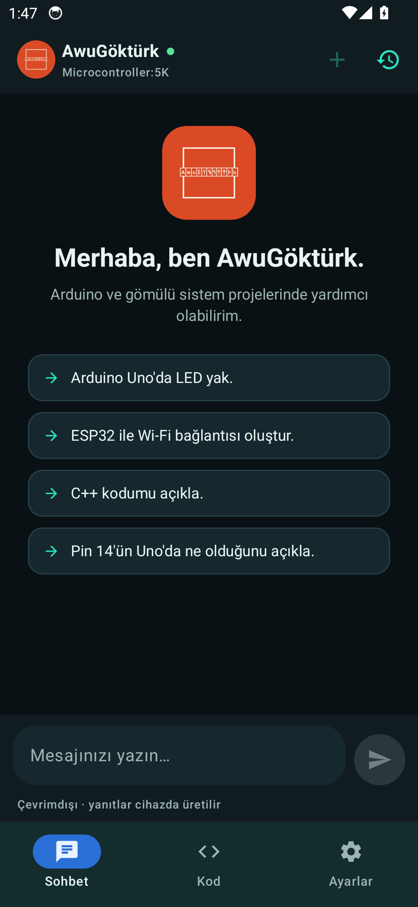

# AwuGöktürk Embedded Agent AI




Mevcut `awu-gokturk-5k` projesinin üzerine kurulu, **modüler gömülü sistem
kodlama ajanı**. Arduino Uno, Arduino Mega 2560 ve (klasik) ESP32 için kod üretir,
üretilen kodu denetler ve emin olmadığında **tahmin etmek yerine sorar / dürüstçe
reddeder**.

> Mevcut 5K parametreli sınıflandırıcı **yalnızca** Arduino Uno odaklı görev-türü
> sinyali olarak kullanılır. ESP32/Mega için kod **üretilir**; model bu kartlarda
> **çalıştırılmaz**.

## Android uygulaması (çevrimdışı)

Bu ajanın tamamen **cihazda / internetsiz** çalışan Android sürümü `android/`
altındadır. Mevcut Python paketi (`awa_agent/`) **yeniden yazılmadan** Chaquopy ile
cihazda çalıştırılır; arayüz Kotlin + Jetpack Compose'dur. 5K modeli, torch
olmadan JSON ağırlıklardan saf Python ile çalışır (`classifier5k_lite.py`).
Debug APK **gerçekten derlendi** ve **Android 14 emülatöründe çalıştırıldı** (sohbet +
kod üretimi + AwuGuard + 5K yüklü; **uçak modunda da çalışır**).
Ayrıntı ve derleme adımları: **`android/README_ANDROID.md`**.

## Dizin yapısı

```
embedded_agent/
  DESIGN.md              Mimari + kapsam + dürüst sınırlar
  REPORT.md              Teslimat raporu (6 başlık)
  README.md              Bu dosya
  awa_agent/             Çekirdek paket
    agent.py             Orkestratör (tüm boru hattı + sohbet katmanı)
    intent_router.py     Intent Router (8 sohbet kategorisi + ince intent)
    chat_knowledge.py    Türkçe sohbet/kavram bilgi kaynağı (kural tabanlı)
    board_resolver.py    Board Resolver
    requirement_parser.py Requirement Parser
    knowledge_registry.py Knowledge/Library Registry
    code_generator.py    Code Generator
    awu_guard.py         AwuGuard
    build_validator.py   Build Validator (host sözdizimi)
    test_generator.py    Test Generator
    response_handler.py  Response Handler
    classifier5k.py      Mevcut 5K sınıflandırıcı köprüsü (salt-okunur; torch)
    classifier5k_lite.py 5K çıkarımı, saf Python (torch YOK → Android)
    android_bridge.py    Android (Chaquopy) JSON köprüsü
    boards/              Kart profilleri (base + uno + mega2560 + esp32 + registry)
    stubs/               Host derleme için Arduino/ESP32 başlık taklidi
  tests/                 unittest paketi (test_agents + test_chat + test_android_bridge + test_arduino_accuracy)
  examples/demo.py       Kabul senaryoları demosu
  chat_terminal.py       Basit interaktif sohbet terminali
  tools/                 Veri seti üreteci + 5K ağırlık dışa aktarımı
  android/               Çevrimdışı Android uygulaması (Kotlin + Compose + Chaquopy)
    build_apk.sh         APK derleme betiği (JDK/Gradle otomatik bulunur)
    emulator_test.sh     Emülatör duman testi (başsız; sohbet/kod doğrular)
    screenshots/         Emülatörde çalışan uygulamanın ekran görüntüleri
  data_agent/            Yeni veri seti şeması + örnek set (eğitim YOK)
```

## Sohbet kategorileri

Gelen mesaj şu kategorilerden birine yönlendirilir (`IntentResult.category`):

`greeting`, `identity`, `general_chat`, `creative_writing`, `general_knowledge`,
`concept_explanation`, `embedded_coding`, `unsupported`.

- Yalnızca `embedded_coding` mevcut gömülü kodlama ajanına gider; diğer kategoriler
  kart/modül sorusuna dönüşmez.
- `general_knowledge` yalnızca **elle doğrulanmış** kayıtlardan yanıt verir
  (ör. başkentler); kayıt yoksa bilgi uydurulmaz.
- `creative_writing` kısa, **sabit** örnek metinler sunar ve genel amaçlı bir dil
  modeli olduğunu iddia etmez.

## Kurulum / bağımlılık

- Python 3.10+ (geliştirme: 3.14.8).
- `torch` **opsiyoneldir** (yalnızca `classifier5k.py` köprüsü için; yoksa ajan
  çalışmaya devam eder, sınıflandırıcı ipucu devre dışı kalır).
- Host derleme doğrulaması için `g++` (mevcut). Gerçek AVR/ESP32 derlemesi için
  `arduino-cli`/`avr-gcc` gerekir — **bu ortamda yoktur**.

## Komutlar

```bash
cd embedded_agent

# Birim testleri (yalnızca standart kütüphane)
python3 -m unittest discover -s tests -v

# Kabul senaryoları demosu (JSON çıktısı: examples/demo_results.json)
python3 examples/demo.py

# Sohbet testleri (ayrı dosya)
python3 -m unittest discover -s tests -p "test_chat.py" -v

# İnteraktif sohbet
python3 chat_terminal.py

# Örnek ajan veri seti üret (EĞİTİM YAPMAZ)
python3 tools/generate_agent_dataset.py
```

## Hızlı kullanım

```python
from awa_agent.agent import AwuGokturkAgent
from awa_agent.response_handler import render_markdown

ag = AwuGokturkAgent()
r = ag.handle("Arduino Uno'da 7. pindeki LED'i yak.")
print(render_markdown(r))
print(r.code)
```

## Durum

- Testler: **67/67 birim testi geçti** (37 ajan + 30 sohbet), kabul senaryoları
  **19/19 geçti**.
- Derleme: yalnızca **host sözdizimi** (`g++ -fsyntax-only`, stub başlıklar).
  Gerçek hedef derleme bu ortamda **yapılamaz**.
- Sohbet/kavram katmanı **kural tabanlıdır**; 5K modeli genel sohbet için
  kullanılmaz, kapsamı dışındaki konularda bilgi uydurulmaz.
- Eğitim: **yapılmadı** (onay gerekir). Ayrıntı: `REPORT.md`.
